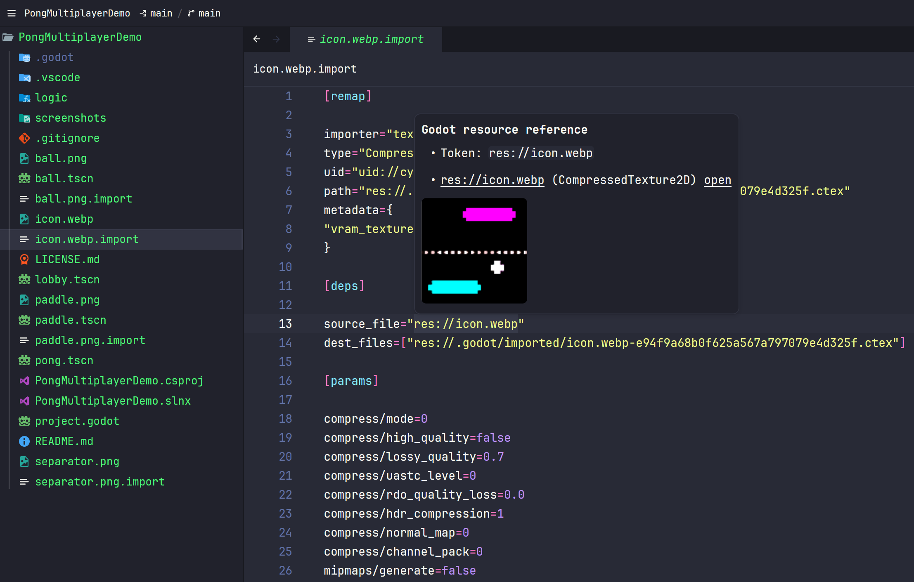

# Godot Files for Zed

Godot file and scripting support for Zed.

## Features

- Syntax highlighting for Godot scenes, resources, GDShader and GDScript.
- Jump to resources through `uid://`, `res://`, `ExtResource` and `SubResource`.
- Hover information with resolved paths, resource types and image thumbnails.
- UID indexing from resource headers, `.uid` sidecars and `.import` metadata.
- GDScript language service and debugging through the Godot editor.

C# language support and debugging are provided by [zed-csharp](https://github.com/kevin-mueller/zed-csharp).



## Installation

Run `zed: install dev extension` in Zed and select this repository. Disable the
upstream GDScript extension if installed.

The resource server is found in this order: a configured binary path, local
installation, cached release, then automatic download from GitHub Releases.

To build and install the server locally:

```sh
cargo install --path crates/gdfiles-lsp
```

The resource server starts when opening Godot Resource, Godot UID or GDShader files.

## GDScript

For completion, diagnostics and navigation:

1. Open the same project in the Godot editor and keep it running.
2. In Godot's Editor Settings, search for **Language Server** and check its port
   (default: `6005`).
3. Open a `.gd` file in Zed. The extension connects to `127.0.0.1:6005` through
   `gdfiles-lsp`; it does not start Godot for you.

### C# projects or syntax highlighting only

If you do not need the GDScript language service, disable it in Zed's settings:

```json
{
  "languages": {
    "GDScript": { "language_servers": [] }
  }
}
```

This prevents the GDScript language service and bridge process from starting.
GDScript highlighting, resource navigation, image previews and C# support remain
available without a running Godot editor.

### Connection settings

If Godot uses a different host or port, match it in Zed's settings:

```json
{
  "lsp": {
    "gdscript": {
      "settings": {
        "bridge": {
          "host": "127.0.0.1",
          "port": 6005,
          "connectTimeoutMs": 5000
        }
      }
    }
  }
}
```

If Zed reports `Server reset the connection` with `Connection refused` in stderr,
the bridge could not connect to Godot's language server. Check that Godot has the
project open and that the host and port match, then restart the GDScript language
server in Zed or reopen the Zed window. Increasing `connectTimeoutMs` will not fix
a port with no server listening. If you do not need GDScript features, use the
disable setting above instead.

### GDScript debugging

Keep the project open in Godot for debugging as well. The `godot` adapter connects
to the editor's debug adapter at `127.0.0.1:6006`, separate from the LSP port `6005`.
Add a launch or attach task to `.zed/debug.json`:

```json
[
  { "adapter": "godot", "label": "Godot: launch", "request": "launch" },
  { "adapter": "godot", "label": "Godot: attach", "request": "attach" }
]
```

Use `netcoredbg` from the C# extension for C# debugging.

## Image previews

PNG, JPEG, WebP, SVG, ICO, BMP, GIF, TGA, TIFF, DDS and HDR are supported.
GIF previews use the first frame. DDS support covers DXT1/DXT3/DXT5.
SVG previews render vector shapes without text or embedded images; filtered SVGs show metadata.
Thumbnails fit within 192 × 128 px, keep their aspect ratio and never enlarge small images.

To select a binary or disable previews, add to Zed's settings:

```json
{
  "lsp": {
    "gdfiles-lsp": {
      "binary": { "path": "/absolute/path/to/gdfiles-lsp" },
      "initialization_options": { "enablePreview": false }
    }
  }
}
```

## Thanks

- [zed-gdscript](https://github.com/grndctrl/zed-gdscript) — original extension.
- [Godot Files for VS Code](https://github.com/AlfishSoftware/godot-files-vscode) — resource navigation and preview reference.
- [tree-sitter-gdscript](https://github.com/PrestonKnopp/tree-sitter-gdscript) and [tree-sitter-godot-resource](https://github.com/PrestonKnopp/tree-sitter-godot-resource) — Godot grammars.
- [tree-sitter-gdshader](https://github.com/airblast-dev/tree-sitter-gdshader) — GDShader grammar and highlight queries.
- [Zed extension API](https://github.com/zed-industries/zed/tree/main/crates/extension_api) and [lsp-server](https://github.com/rust-lang/rust-analyzer/tree/master/lib/lsp-server) — editor integration and LSP transport.
- [image](https://github.com/image-rs/image) and [resvg](https://github.com/linebender/resvg) — image decoding and SVG rendering.
